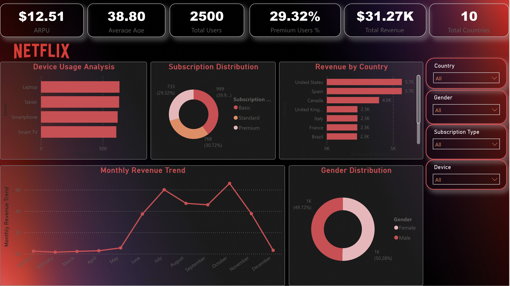
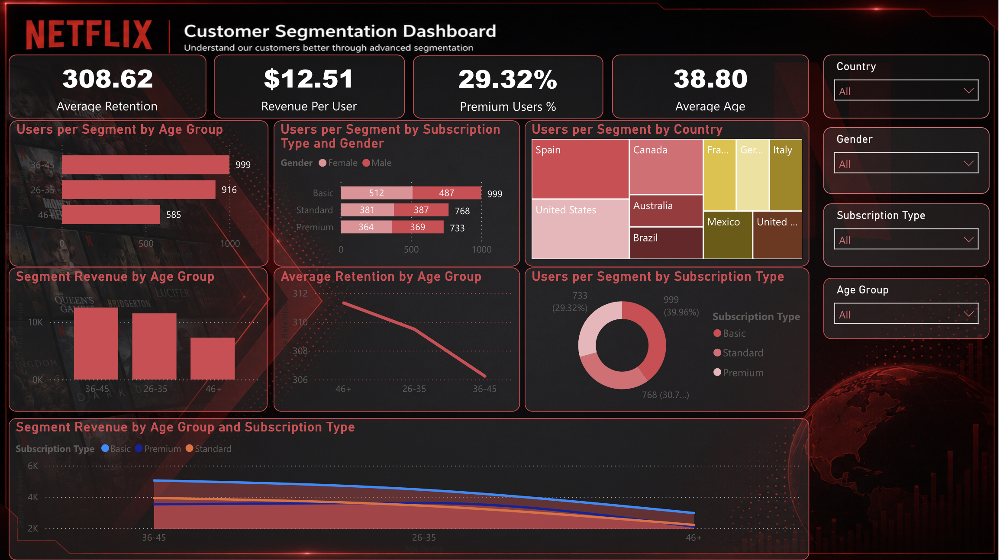

# Netflix Customer Segmentation Dashboard (Power BI)

A two-page Power BI dashboard that analyzes a Netflix userbase by subscription type, country, gender, device, age group, monthly revenue, and retention. It is designed to make customer segments easy to compare through interactive filters.

> This is a portfolio analysis using a supplied dataset. It is not an official Netflix report.

## Dashboard previews

### Customer overview



### Customer segmentation



## Business questions

- What is the total customer base, average revenue per user, and premium-subscription share?
- Which countries contribute the most monthly revenue?
- How are users distributed across subscription plans, devices, genders, and age groups?
- Which customer segments generate more revenue and show stronger retention?

## Key metrics

| Metric | Value |
| --- | ---: |
| Total users | 2,500 |
| Total monthly revenue | $31.27K |
| Average revenue per user | $12.51 |
| Average age | 38.80 years |
| Premium users | 29.32% |
| Countries | 10 |

## Key observations

- The **Basic** plan is the largest subscription segment with 999 users, followed by Standard (768) and Premium (733).
- The userbase is nearly balanced by gender: 1,257 female and 1,243 male users.
- The United States and Spain generate the highest monthly revenue in the supplied dataset.
- The dashboard segments revenue and retention by age group, subscription type, gender, country, and device.

## Data model

The dashboard uses a central Netflix userbase table linked to lookup tables for subscription type, device, country, and gender.

| Dataset | Purpose |
| --- | --- |
| `netflix_userbase.xlsx` | Customer-level user, revenue, date, age, subscription, country, gender, and device fields |
| `lookups/subscription.xlsx` | Subscription plan mapping |
| `lookups/device.xlsx` | Device mapping |
| `lookups/country.csv` | Country mapping |
| `lookups/gender.csv` | Gender mapping |
| `supplemental/netflix_data_2.xlsx` | Supplemental workbook retained from the original project package |

## Repository structure

```text
.
├── assets/
│   ├── dashboard-overview.png
│   └── dashboard-segmentation.png
├── data/
│   ├── netflix_userbase.xlsx
│   ├── lookups/
│   └── supplemental/
├── power-bi/
│   └── netflix_customer_segmentation.pbix
├── LICENSE
└── README.md
```

## Tools and techniques

- Microsoft Power BI
- Power Query for data preparation
- Data-model relationships and lookup tables
- DAX measures for customer, revenue, and retention metrics
- Interactive slicers and dashboard design

## How to use

1. Download the repository and open `power-bi/netflix_customer_segmentation.pbix` in Power BI Desktop.
2. If prompted to refresh the model, map the source files to the corresponding files in `data/`.
3. Use the country, gender, subscription type, device, and age-group filters to explore the customer segments.

## Notes

The userbase spans join dates from September 2021 to June 2023. The figures represent the supplied sample dataset and should be interpreted as a portfolio case study, not live Netflix business data.

## Author

**Soumyadeep Masanta**  
GitHub: [@Soumyadeepmasanta](https://github.com/Soumyadeepmasanta)
